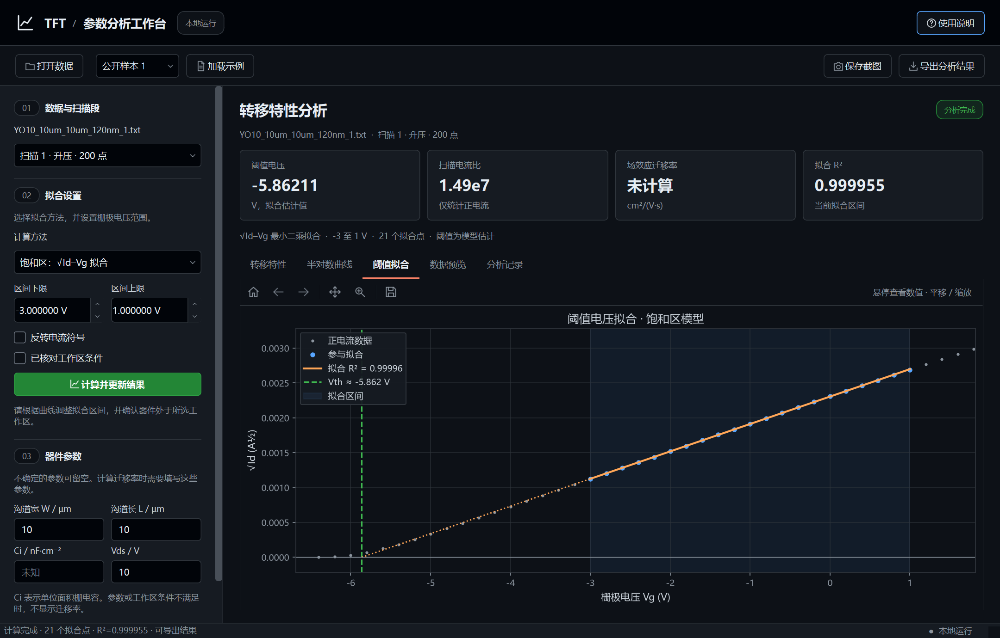

# TFT 参数分析系统

这是一个用 Python 和 PySide6 编写的桌面程序，用于查看 TFT 转移特性数据、拟合选定区间并提取相关参数。程序以公开的 a-IGZO TFT 实测数据作为示例，也支持导入 TXT、CSV、TSV 和 XLSX 文件。界面采用 GitHub Dark 风格，计算在本机完成，无需启动网页服务或连接大模型接口。

当前版本为 **0.3.1**。本版本面向固定正漏极偏置下的 n 型 TFT 单条扫描分析；它适合课程设计中的数据处理与可视化练习，不是器件参数认证工具。示例数据的来源、器件条件和不确定性见[数据来源说明](docs/SOURCE_DATA.md)。

## 界面预览



更多界面截图见 [`docs/screenshots/`](docs/screenshots/)，包括空状态、半对数曲线、数据预览、分析记录和曲线悬浮信息。

## 安装与启动

在 Windows 上安装 Python 3.13 后，双击项目目录中的 `安装依赖.bat`。依赖安装完成后，双击 `启动程序.bat` 即可打开软件。也可以在项目目录的 PowerShell 中运行：

```powershell
python -m venv .venv
.\.venv\Scripts\python.exe -m pip install -r requirements.txt
.\.venv\Scripts\python.exe app.py
```

安装依赖时需要网络；安装完成后，导入、分析和导出均在本机运行。依赖版本列在 `requirements.txt` 中，开发环境的完整版本记录在 `requirements-lock.txt` 中。当前提供源码运行方式，EXE 打包尚未完成。

## 基本操作

1. 从顶部的样本列表选择示例，点击“加载示例”；也可以点击“打开数据”导入自己的文件。
2. 导入数据时，选择电压列、电流列并确认原始单位。程序会将数值统一换算为 V 和 A，并按采集顺序识别升压、降压扫描。
3. 选择拟合方法和电压区间。界面中的初始区间用于开始操作，建议先查看曲线再按需要调整。
4. 点击“计算并更新结果”。结果区会显示阈值电压、扫描电流比、拟合质量和数据提示。扫描电流比指当前扫描段内正电流最大值与最小值之比。迁移率只会在必要器件条件齐全且工作区检查通过时计算。
5. 鼠标移到曲线上可查看附近采样点的信息；参与拟合的数据点还会显示拟合值和残差。拟合线上的位置会标为模型估计值。
6. 点击“导出分析结果”保存本次分析，或点击“保存截图”留存当前窗口画面。

悬浮信息用于查看数据，不会改变计算结果，也不会出现在单独导出的曲线图片中。半对数图显示电流绝对值；原始电流符号仍保留在数据和导出记录中。

## 计算方法与适用范围

程序提供饱和区的 `√Id–Vg` 线性拟合和线性区的 `Id–Vg` 线性拟合。阈值电压由所选模型和拟合区间估计。计算迁移率还需要沟道宽度 `W`、沟道长度 `L`、单位面积栅电容 `Ci`、漏极偏置 `Vds`，并需满足相应工作区条件。详细公式及检查条件见界面说明和 `tft_analysis/extraction.py`。

拟合的 R² 较高只说明所选数据在拟合空间内接近直线，不能单独证明器件符合该物理模型。公开示例是双栅器件，具体扫描栅端和应采用的电容模型未完全明确，因此示例默认不提供栅电容，也不会给出迁移率。示例的文件后缀 `_1`、`_2`、`_3` 也没有被来源材料明确解释为重复扫描还是不同器件，不能据此进行独立样本统计。

程序支持最多 50 MB、20 万行的文本或 XLSX 文件。复杂仪器导出格式、多段混合文本、带引号分隔字段和小数逗号暂不支持。导入时会记录并排除空值、非数值和无穷值；不同扫描方向分别处理，重复电压不会被自动平均。

## 导出内容

每次导出会在所选位置创建带时间戳的文件夹，保存参数表、分析记录、当前扫描数据、拟合数据与残差、三幅 240 dpi 曲线图，以及当前界面截图。分析记录包含数据文件路径与 SHA-256、列和单位、扫描段、拟合方法与区间、器件条件、结果及提示。无法满足条件的参数会留空。

曲线图片使用白色背景，便于放入文档；界面截图保留深色主题。导出不会改写原始数据。分析记录用于复核本次计算，但程序目前不能从记录文件恢复完整会话。

## 项目结构

```text
app.py                       桌面程序入口
tft_analysis/                界面、数据读取、参数提取、绘图和导出模块
data/raw/                    公开数据集原始文件与参考材料
data/example_metadata.json   示例数据的来源及已知条件
docs/SOURCE_DATA.md          数据来源、许可和条件说明
docs/VERIFICATION.md         功能验证记录
docs/screenshots/            界面截图
tests/                       计算、数据导入、界面与导出验证
requirements.txt             运行依赖
requirements-lock.txt        已验证环境的完整依赖版本
安装依赖.bat                 Windows 依赖安装脚本
启动程序.bat                 Windows 启动脚本
```

公开材料中的 `Script.py` 随原始数据一并保留，仅作为来源和计算方法的参考，不会由本程序导入或执行。本程序采用所选区间内的多点最小二乘拟合；该方法与参考脚本使用的最大斜率两点切线法不同。

## 验证

已验证的环境和结果记录在[功能验证说明](docs/VERIFICATION.md)。在项目环境中，可运行以下命令重现自动化检查：

```powershell
.\.venv\Scripts\python.exe -m unittest discover -s tests -v
.\.venv\Scripts\python.exe tests\gui_smoke.py
```

理想曲线用于检查公式和单位换算；公开实测曲线用于检查数据读取、绘图、拟合及导出流程。两类数据在验证记录中分别说明。
