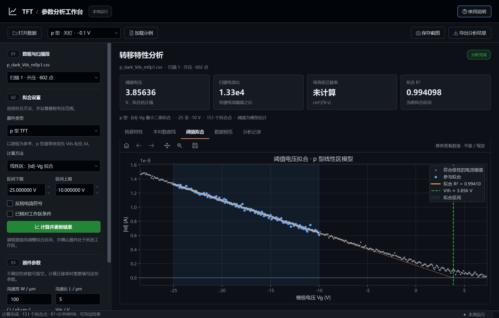

# TFT 参数分析系统

这是一个用 Python 和 PySide6 编写的桌面程序，用于查看 TFT 转移特性数据、拟合选定区间并提取相关参数。程序以公开的 a-IGZO TFT 和 p 型有机 TFT 实测数据作为示例，也支持导入 TXT、CSV、TSV 和 XLSX 文件。界面采用 GitHub Dark 风格，计算在本地完成。

当前版本为 **0.4.0**。本版本面向固定漏极偏置下的 n 型和 p 型 TFT 单条扫描分析；本程序面向的是开发者的课程设计中的数据处理与可视化练习过程，不是专业的器件参数认证工具。示例数据的来源、器件条件和不确定性说明可以参考[数据来源说明](docs/SOURCE_DATA.md)。

## 界面预览


p 型拟合页面（IIT/Flexterra 公开实测数据）：



更多界面截图见 [`docs/screenshots/`](docs/screenshots/)，包括空状态、半对数曲线、数据预览、分析记录和曲线悬浮信息。

## 安装与启动

在 Windows 上安装 Python 3.13 后，双击项目目录中的 `安装依赖.bat`。依赖安装完成后，双击 `启动程序.bat` 即可打开软件。也可以在项目目录的 PowerShell 中运行：

```powershell
python -m venv .venv
.\.venv\Scripts\python.exe -m pip install -r requirements.txt
.\.venv\Scripts\python.exe app.py
```

安装依赖时需要网络；安装完成后，导入、分析和导出均在本机运行。依赖版本列在 `requirements.txt` 中，`requirements-lock.txt` 记录开发环境的依赖版本。当前提供源码运行方式，EXE 打包尚未完成。

## 基本操作

1. 从顶部的样本列表选择 n 型或 p 型公开示例，点击“加载示例”，程序会带入对应的器件类型和已知条件；也可以点击“打开数据”导入自己的文件。
2. 导入数据时，选择电压列和电流列，并确认原始单位；导入后在左侧选择器件类型。p 型数据应使用以源极为参考的带符号 Vg、Vds 和 Id；p 型器件通常有负 Vds 和负 Id，但耗尽型器件不要求电压阈值统一为负值。如果仪器只导出 p 型正电流幅值，可勾选反转电流符号。程序将数值换算为 V 和 A，并按采集顺序识别升压、降压扫描。
3. 选择拟合方法和电压区间。界面中的初始区间用于开始操作，建议先查看曲线再按需要调整。
4. 点击“计算并更新结果”。结果区会显示阈值电压、扫描电流比、拟合质量和数据提示。扫描电流比按所选器件极性，取当前扫描段内与该极性一致的非零导通电流幅值最大值与最小值之比。迁移率只会在必要器件条件齐全且工作区检查通过时计算。
5. 鼠标移到曲线上可查看附近采样点的信息；参与拟合的数据点还会显示拟合值和残差。拟合线上的位置会标为模型估计值。
6. 点击“导出分析结果”保存本次分析，或点击“保存截图”留存当前窗口画面。

悬浮信息用于查看数据；半对数图显示电流绝对值；原始电流符号仍保留在数据和导出记录中。

p 型示例名称中的“开灯”和“关灯”指测量时的照明状态，不是器件的导通和关断。来源未给出定量光照条件，具体说明见 [p 型数据说明](docs/P_TYPE_DATA.md)。

## 计算方法与适用范围

程序提供饱和区的 `√|Id|–Vg` 线性拟合和线性区的 `|Id|–Vg` 线性拟合。原始带符号测量值仍会显示并导出。阈值电压由所选模型和拟合区间估计。计算迁移率还需要沟道宽度 `W`、沟道长度 `L`、单位面积栅电容 `Ci`、漏极偏置 `Vds`，并需满足相应工作区条件。详细公式及检查条件见界面说明和 `tft_analysis/extraction.py`。

拟合的 R² 较高只从数学计算的角度说明了所选数据在拟合空间内接近直线，但不能单独证明器件符合该物理模型。n 型公开示例是双栅器件，具体扫描栅端和应采用的电容模型未完全明确，因此默认不提供栅电容。p 型示例的栅压由原始扫描设置恢复，栅电容也只可根据材料参数估算；详细说明见 [p 型数据说明](docs/P_TYPE_DATA.md)。两类示例均不会默认给出迁移率。

程序支持最多 50 MB、20 万行的文本或 XLSX 文件。复杂仪器导出格式、多段混合文本、带引号分隔字段和小数逗号暂不支持。导入时会记录并排除空值、非数值和无穷值；不同扫描方向分别处理，重复电压不会被自动平均。

## 导出内容

每次导出会在所选位置创建带时间戳的文件夹，保存参数表、分析记录、当前扫描数据、拟合数据与残差、三幅 240 dpi 曲线图，以及当前界面截图。分析记录包含数据文件路径与 SHA-256、列和单位、扫描段、拟合方法与区间、器件条件、结果及提示。无法满足条件的参数会留空。

曲线图片使用白色背景，便于放入文档；界面截图保留深色主题。导出不会改写原始数据。分析记录用于复核本次计算，但程序目前不能从记录文件恢复完整会话。

## 项目结构

```text
app.py                       桌面程序入口
tft_analysis/                界面、数据读取、参数提取、绘图和导出模块
data/raw/                    公开数据集原始文件与参考材料
data/example_catalog.json    界面中的示例与默认设置
data/example_metadata.json   n 型数据的来源及已知条件
data/p_type_metadata.json    p 型原始数据与转换说明
data/examples/               从原始记录整理出的示例表格
docs/SOURCE_DATA.md          数据来源、许可和条件说明
docs/P_TYPE_DATA.md          p 型数据的来源与使用说明
docs/screenshots/            界面截图
requirements.txt             运行依赖
requirements-lock.txt        开发环境的依赖版本记录
安装依赖.bat                 Windows 依赖安装脚本
启动程序.bat                 Windows 启动脚本
```

公开材料中的 `Script.py` 随原始数据一并保留，仅作为来源和计算方法的参考，不会由本程序导入或执行。本程序采用所选区间内的多点最小二乘拟合；该方法与参考脚本使用的最大斜率两点切线法不同。
